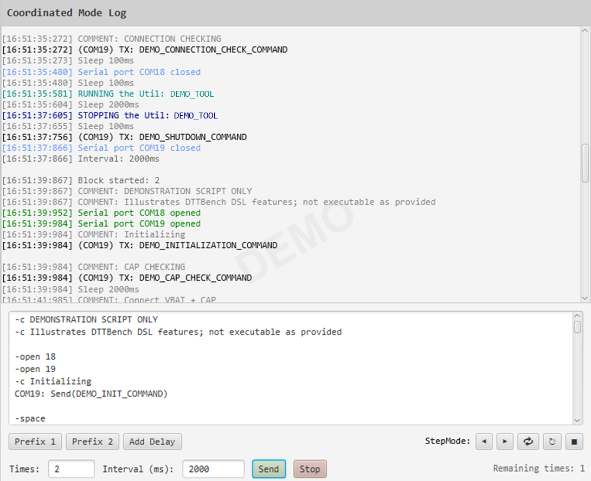

# DTTBench - Device Testing Toolkit Bench

**A testing workbench for electronic devices.**

DTTBench brings test automation, execution control, logging, and data visualization into one workspace,
helping turn repetitive checks into structured, repeatable test workflows.

## Why DTTBench?

DTTBench started as a solution to a practical problem: 
repetitive manual tests and fragmented logs across multiple serial ports.

I needed to:
- **Automate** command sequences with precise timing
- **Synchronize** testing across multiple devices
- **Process** responses from devices
- **Visualize** numeric responses
- **Organize** the testing workflow in one place

See the [backlog](./BACKLOG.md) for planned improvements and features.

---

## Overview

For detailed usage instructions, see the [User Guide](docs/user_guide.md).  
The examples shown in this overview are based on [`script_example`](Scripts/script_example.txt) and its corresponding log in [`log_example`](Logs/log_example.txt).  
These files contain placeholder content for **demonstration purposes only** and are not executable test scripts.

**The Workbench**

**Coordinated Mode** allows you to execute scripts across multiple serial ports. Device responses are processed by command handlers located in the [`devices`](src/main/java/com/terminal/handlers/devices) package.
The handler architecture can be extended by implementing the [`CommandHandler`](src/main/java/com/terminal/handlers/CommandHandler.java) interface,
using [`example`](src/main/java/com/terminal/handlers/DefaultCommandHandler.java) and registering the new handler in [`HandlerRegistry`](src/main/java/com/terminal/handlers/HandlerRegistry.java).  
See the [Architecture Overview](docs/architecture.md) for details.

*Coordinated Mode interface*

**Measurement Limits**

Configurable measurement limits visualization.
Use **Save Errors** in the log context menu to save
[`errors and warnings`](Logs/log_example_errors.txt)
separately from the full log.

*Configured measurement limits*

**Block execution**

Numbered blocks in log are generated when the **Times and Intervals** fields are configured.

*Block delimitation in log*

**Step Mode**

Execute script one step at a time using the **Next Step** button. The current line is highlighted during execution.

*Step-by-step script execution*

**Plotter**

Visualize numeric execution results interactively. **Export** measurement data as **CSV** and plots as **PNG**.

*Interactive plotter*

## Operating Modes

| Mode | Scripts | Ports               | Primary Use Case |
|------|---------|---------------------|------------------|
| **Separate** | 2 independent | 1 per script        | Comparing two devices side-by-side with isolated logs. |
| **Coordinated** | 1 shared | Multiple (up to 12) | Testing a system of interacting devices from a single timeline. |

---

## Key Features

- **Script Automation** — automate command sequences with configurable timing, loops, and repeat counts.
- **Separate Mode** — execute two independent scripts, each using its own serial port and separate log.
- **Coordinated Mode** — execute scripts across multiple ports with coordinated execution and logging.
- **Step Mode** — execute scripts step by step.
- **Measurement Limits** — define acceptable value ranges and identify out-of-range results.
- **Response Handlers** — extend response parsing with custom device-specific handlers.
- **Data Visualization** — plot numeric execution results interactively and export data to CSV and plots to PNG.
- **Logging** — record execution output and save logs for analysis.

---

## Getting Started

### Download

Download the latest Windows release from [GitHub Releases](https://github.com/IuriiMel/DTTBench/releases) and extract the archive.

### Run

Launch `DTTBench.exe` from the extracted directory. Keep the files and folders in place, as they may be required for the application to work correctly.

For usage instructions, see the [User Guide](docs/user_guide.md).

## Building from Source

DTTBench is built with Java 21, Maven, JavaFX 21, and GluonFX.

The project supports native Windows builds. For build configuration and GraalVM Native Image-specific requirements, see the 
[Build Guide](docs/build.md).