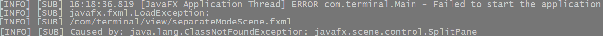

# Building DTTBench

## Requirements

DTTBench uses Maven and GluonFX to build a native Windows application from Java source code.

Required tools:

- **JDK 21** — for compiling and running the Java application.
- **Maven** — for dependency management and build execution.
- **JavaFX 21** — the application's UI framework.
- **GluonFX Maven Plugin** — for native compilation and packaging.
- **Microsoft Visual C++ (MSVC) Build Tools** — the native compiler toolchain.
- **Windows SDK** — required for native Windows builds.

### Microsoft C++ Build Tools

Native Windows compilation requires **Microsoft C++ Build Tools**.

If Visual Studio is not installed, download [Visual Studio Build Tools](https://visualstudio.microsoft.com/visual-cpp-build-tools/)
and select **Desktop development with C++** in the installation menu.

Ensure that the installation includes:
- MSVC C++ x64/x86 build tools.
- A compatible Windows SDK, such as the Windows 11 SDK.

Run the build from **x64 Native Tools Command Prompt for Visual Studio**. This terminal configures the environment variables and paths required by the MSVC toolchain.

## Reflection Configuration

GraalVM Native Image performs static analysis at build time, so classes accessed dynamically through reflection may not be detected automatically.

If you add functionality that relies on reflection, check whether the required classes need to be included in the
`reflectionList` in the **GluonFX Maven Plugin** configuration in [`pom.xml`](../pom.xml).

Missing reflection entries may cause runtime errors in the native application even when the same code works correctly on the JVM.

## DLL Resources

GluonFX does not automatically include DLL files in the native application package by default.   
If the application depends on DLLs, include them in the `resourcesList` in the **GluonFX Maven Plugin** configuration in [`pom.xml`](../pom.xml). 

## JNI Configuration

If the application uses JNI, configure the required JNI classes in the `jniList`
in the **GluonFX Maven Plugin** configuration in [`pom.xml`](../pom.xml). 

## Building the Native Application

Open **x64 Native Tools Command Prompt for VS** and navigate to the project root directory.  
Build the native application by running:

```shell
mvn clean gluonfx:build
```

GluonFX coordinates the native compilation and linking process using GraalVM Native Image and the installed Windows toolchain.  
The native executable is located at:

```shell
target/gluonfx/x86_64-windows/DTTBench.exe
```

Verify the result by launching the native application:
```shell
mvn gluonfx:nativerun
```
The application runs as a native executable, and its console output is displayed
in the terminal.   
This output can be used to monitor application startup
and inspect log messages or errors.  
The build configuration is defined in [`pom.xml`](../pom.xml).

## Troubleshooting: Missing Reflection Configuration

A native build may complete successfully even when the application fails to start
because a class required by reflection is not available in the native image.

For example, I commented `SplitPane` in the `reflectionList` in the **GluonFX Maven Plugin** configuration in [`pom.xml`](../pom.xml).  
The screenshot below shows a startup error in the console output that occurs when loading the JavaFX component.
```shell
mvn gluonfx:nativerun
```


If this occurs, inspect the log and identify the class that
could not be loaded or accessed.
Check the `reflectionList` configuration in
[`pom.xml`](../pom.xml) and ensure that the required class is included.

**Note:** `BUILD SUCCESS` confirms that the native build completed,
but it does not guarantee that the application will start successfully.
Always test the native application after building it.

## Custom Application Icon

To use a custom application icon, name the icon `icon.ico` and place it in `src/windows/assets` before building the application.

The icon will be included in the native Windows executable automatically.