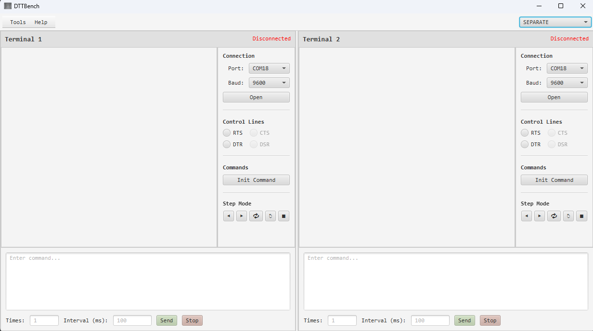
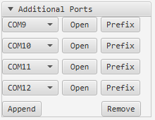
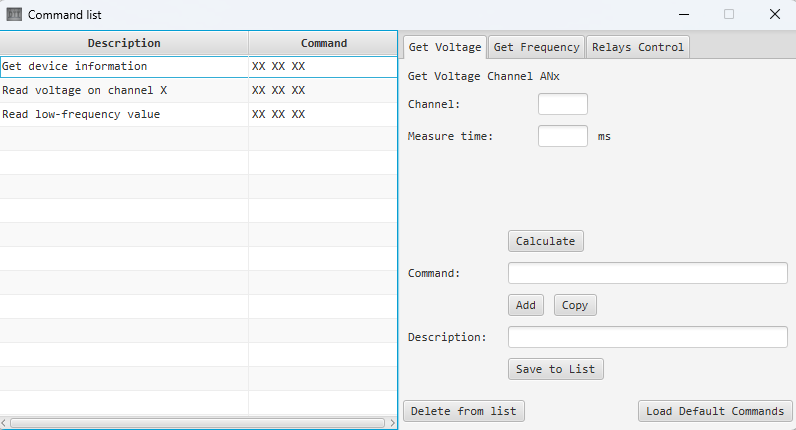
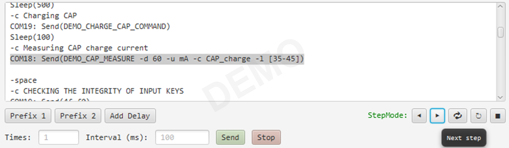
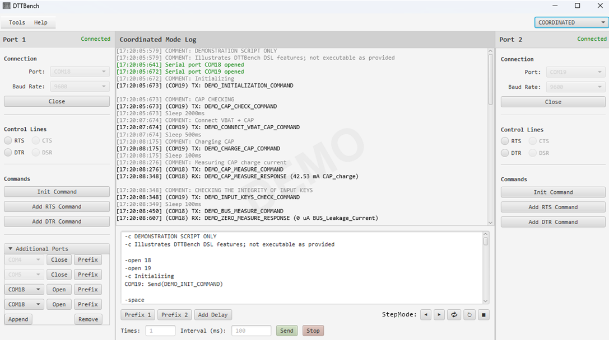
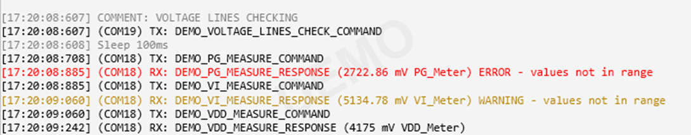
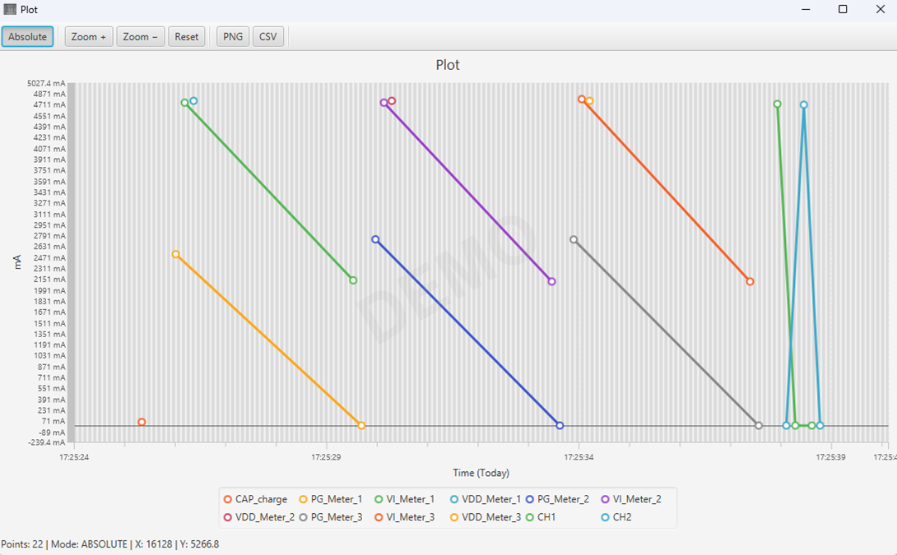
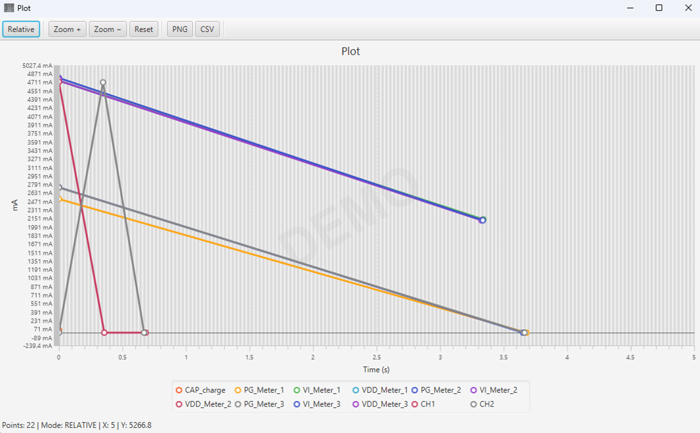

## 1. Overview

DTTBench (Device Testing Toolkit Bench) is a toolkit for device testing, command execution, and debugging. It helps organize repetitive test procedures, coordinate communication with multiple devices, and analyze execution results.

The application supports two operating modes:

- **Separate Mode** — work with a device through an individual session.
- **Coordinated Mode** — execute test procedures while coordinating communication across multiple sessions.

DTTBench supports script-based execution, command processing, logging, step-by-step debugging, and visualization of numeric results. These features help make test procedures more repeatable and simplify the analysis of device behavior.

The application currently communicates with devices through serial ports.



## 2. Connecting to Serial Ports

DTTBench monitors available serial ports in real time and updates the port list when ports appear or disappear. Ports matching **"com0com"** are excluded from the list.

Make sure the selected port corresponds to the connected device and that the communication settings match the device requirements.

### Additional Ports

Coordinated Mode provides 4 additional port entries by default. 
Use the **Append** button to add more entries, up to a maximum of 10 additional ports. 
Use the **Remove** button to remove an entry when it is no longer needed.  

`Note:` Removing an entry while its port is open may cause issues when closing the port.
See [Port Management](architecture.md#port-management) for details.



## 3. Commands and Command Generators

DTTBench provides command generators and a reusable command list to simplify command preparation during device testing.

### Command Generators

Open **Tools → Command List** to access the command list and command generators.  
The available command generators are organized into separate tabs:

- [`VoltageTab`](../src/main/java/com/terminal/controller/tabs/VoltageTab.java)
- [`FrequencyTab`](../src/main/java/com/terminal/controller/tabs/FrequencyTab.java)
- [`RelayTab`](../src/main/java/com/terminal/controller/tabs/RelayTab.java)

Each tab provides controls for configuring the command. The common interface includes the following actions,
implemented in [`BaseTabContent`](../src/main/java/com/terminal/controller/tabs/BaseTabContent.java):

- **Calculate** — generates the command using the current parameters.
- **Add** — inserts the generated command at the current caret position in the active command editor.
- **Copy** — copies the generated command to the clipboard.
- **Save to List** — saves the generated command and its description to the command list.


### Command List

DTTBench provides a **default** set of commands implemented in [`CommandListController`](../src/main/java/com/terminal/controller/CommandListController.java) in its `loadDefaultCommands()` method.  
On the first launch, the application creates [`commands.json`](../commands.json) and initializes the command list with the **default** commands.  
To insert a saved command into the active editor, select it in the list and either double-click it or press **Enter**.  
To remove a command from the list, select it and press **Delete**.



### Adding Custom Command Generators

DTTBench can be extended with custom command generators.

A custom generator implements the [`CommandTab`](../src/main/java/com/terminal/controller/tabs/CommandTab.java) interface,
which defines the generator's name, user interface, command-generation logic, and description.

To add a generator:

1. Create a class that implements [`CommandTab`](../src/main/java/com/terminal/controller/tabs/CommandTab.java).
2. Implement the methods required by the interface, including command generation and description handling.
3. Register the new generator in [`CommandListController`](../src/main/java/com/terminal/controller/CommandListController.java) 
by adding a call to `registerTab()` in its `initialize()` method.

For examples, refer to the existing implementations: [`VoltageTab`](../src/main/java/com/terminal/controller/tabs/VoltageTab.java),
[`FrequencyTab`](../src/main/java/com/terminal/controller/tabs/FrequencyTab.java),
and [`RelayTab`](../src/main/java/com/terminal/controller/tabs/RelayTab.java).

## 4. Working with Scripts

DTTBench allows you to create and execute scripts containing device commands and control instructions.  
Enter one command per line in the script editor.

### Script Syntax

The script engine supports instructions described in [syntax.txt](../syntax.txt).  
Commands can also be addressed to a specific port using a port prefix `COMx: Send()`.
See [`Coordinated Mode`](../src/main/java/com/terminal/controller/CoordinatedModeController.java) for details.

### Executing Scripts

Use the execution controls below the script editor:

- **Times** — specifies how many times the script is executed.
- **Interval (ms)** — specifies the delay between repetitions, in milliseconds.
- **Send** — starts script execution.
- **Stop** — stops the running script.

When script repetition is configured using **Times** and **Interval** fields, the log displays numbered execution blocks.

### Script Editor Context Menu

Right-click the script editor to access the following actions:

- **Save** — saves the script to a text file.
- **Load** — loads a script from a text file.
- **Find & Replace** — searches for text and replaces the next occurrence or all occurrences.
- **Clear** — clears the script editor and also the plotter data.

Press **Ctrl+S** to save the script.

**Find & Replace** is useful when adapting an existing script for another set of ports in **Coordinated Mode**.  
For example, replace `COM1:` with `COM2:` throughout the script to redirect its commands to another port.

### Step-by-Step Execution

Step Mode lets you execute a script one command at a time. The current command is highlighted in the editor.

The Step Mode label turns green when Step Mode is active.

Controls are available:

- **Next Step** — starts Step Mode from the script beginning if it is not started, executes the next command.
- **Previous Step** — moves to the preceding command and executes it again; it does not undo previous device actions.
- **Repeat** — executes the current command again.
- **Restart** — restarts step-by-step execution from the beginning.
- **Stop Step Mode** — exits Step Mode and clears the current command highlight.



## 5. Coordinated Mode

Coordinated Mode lets you execute a single script that sends commands to multiple serial ports. 
It provides two main port panels and supports up to ten additional ports.  
Unlike Separate Mode, commands in the script can target different ports by specifying the port name (`prefix`) before the command.

### Using Prefix

The **Prefix** button inserts a command template for the selected port at the current caret position in the script editor.
The template contains the selected port name `COMx:` and `Send()`, with the caret positioned inside the parentheses.

For example:

```text
COM1: Send(01 02 03)
```

The `COM1:` prefix directs the command to the selected physical serial port.

This lets you combine commands for different ports in one script and control their execution order.



## 6. Measurement Limits and Plotter

### Measurement Limits

Measurement limits allow you to identify numeric values that fall outside an expected range.  
Measurement limits are evaluated by response [`handlers`](../src/main/java/com/terminal/handlers/devices) that support numeric value extraction and limit checking.

Two types of limits are supported:

- **`-l [min-max]`** — defines hard limits. Values outside the range are marked as errors.
- **`-lw [min-max]`** — defines warning limits. Values outside the range are marked as warnings.

Use the appropriate limit option when configuring a command supported by a response handler.

To save error and warning messages separately from the full log, use **Save Errors** in the log context menu.



### Plotter

The Plotter visualizes numeric values extracted from device responses by response [`handlers`](../src/main/java/com/terminal/handlers/devices).
Each plotted result can include a numeric value, its unit, and a comment identifying the measurement.

`Note:` In **Coordinated Mode**, plotting is currently available only for the port displayed in the left panel. 
See [Plotting and Utilities](architecture.md#plotting-and-utilities) for details.

To open a graph, right-click the execution log and select **Plot a graph**.

DTTBench provides two plotting modes:

- **Absolute Plotter** — displays measured values against the time of day.
- **Relative Plotter** — displays measured values relative to the first measurement for each quantity identified by the `-c` comment.

The Plotter supports exporting measurement data to CSV and saving graphs as PNG images.





## 7. Working with the Log

The execution log displays device communication, script execution events, and errors. Each entry includes a timestamp and is color-coded according to its type.

The log can contain:

- **TX / RX** — transmitted commands and received responses.
- **WARNING / ERROR** — warnings and errors.
- **SYSTEM** — script and system messages.
- **Port events** — serial port opening and closing.
- **Execution events** — block execution markers and other script-related messages.

In **Coordinated Mode**, communication entries, warnings, and errors also include the name of the target serial port.

### Log Context Menu

Right-click the log to access the following actions:

- **Save** — saves the log to a text file.
- **Save errors** — saves entries containing warnings and errors to a separate file.
- **Plot a graph** — opens the Plotter for the corresponding session.
- **Clear** — clears the displayed log and resets the associated Plotter data.

Log files are saved to the location selected in the save dialog, which defaults to the configured logs directory.

## 8. Response Handlers

Response [`handlers`](../src/main/java/com/terminal/handlers/devices) process device responses and extract useful information for display in the execution log and plotter.

Each handler defines which commands it supports, whether a response is expected, the delay before reading the response, and how the received data is processed.

DTTBench includes a [`default handler`](../src/main/java/com/terminal/handlers/DefaultCommandHandler.java)
and device-specific [`handlers`](../src/main/java/com/terminal/handlers/devices) for supported commands.

### Adding Custom Response Handlers

DTTBench can be extended with custom response handlers implemented in Java.

A custom handler implements the [`CommandHandler`](../src/main/java/com/terminal/handlers/CommandHandler.java)
interface and provides command matching, response processing, and the expected response delay.
The [`HandlerRegistry`](../src/main/java/com/terminal/handlers/HandlerRegistry.java) manages handler registration and selection.

To add a handler:

1. Create a class that implements [`CommandHandler`](../src/main/java/com/terminal/handlers/CommandHandler.java).
2. Implement the required methods for matching commands and processing responses.
3. Register the handler in [`HandlerRegistry`](../src/main/java/com/terminal/handlers/HandlerRegistry.java).

For examples, refer to the existing implementations in [`devices`](../src/main/java/com/terminal/handlers/devices).

## 9. Configuration

Open **Tools → Config** to edit the application configuration file [`config.txt`](../Config/config.txt).

The configuration file allows you to customize the names of the directories used by DTTBench:

| Property | Default value | Purpose |
|---|---|---|
| `LogsDIR` | `Logs` | Directory for saved logs |
| `ScriptsDIR` | `Scripts` | Directory for scripts |
| `UtilsDIR` | `Utils` | Directory for external utilities |

For example:

```properties
LogsDIR=Logs
ScriptsDIR=Scripts
UtilsDIR=Utils
```

You can change these values to use different directory names. The directories are created automatically if they do not exist.