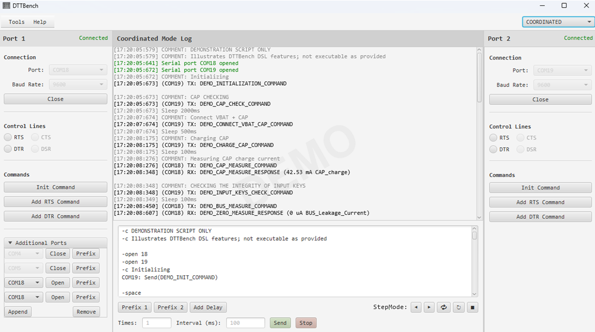

# DTTBench — Device Testing Toolkit Bench

**A testing workbench for electronic devices.**

[DTTBench](https://github.com/IuriiMel/DTTBench) brings test automation, execution control, logging, and data visualization into one workspace, helping turn repetitive checks into structured, repeatable test workflows.

## What is DTTBench?

With DTTBench you can:

- **Automate command sequences** with configurable repeats and timing.
- **Coordinate testing** across multiple serial ports and devices.
- **Monitor execution** and inspect device responses.
- **Log communication** for later analysis and troubleshooting.
- **Visualize measurement data** using interactive plots.
- **Export results** as CSV data and PNG plots.

## Get DTTBench

### Download for Windows

Get the latest version from GitHub Releases.

[**Download the latest release**](https://github.com/IuriiMel/DTTBench/releases/latest)

## Documentation

- [User Guide](docs/user_guide.md) — learn how to use DTTBench and configure test workflows.
- [Architecture](docs/architecture.md) — explore the application's internal structure and component interactions.
- [Build Guide](docs/build.md) — build the native Windows application from source.

## Project

- [Source Code](https://github.com/IuriiMel/DTTBench) — browse the repository.
- [Backlog](https://github.com/IuriiMel/DTTBench/blob/main/BACKLOG.md) — see planned improvements and features.
- [Releases](https://github.com/IuriiMel/DTTBench/releases) — browse available versions.
